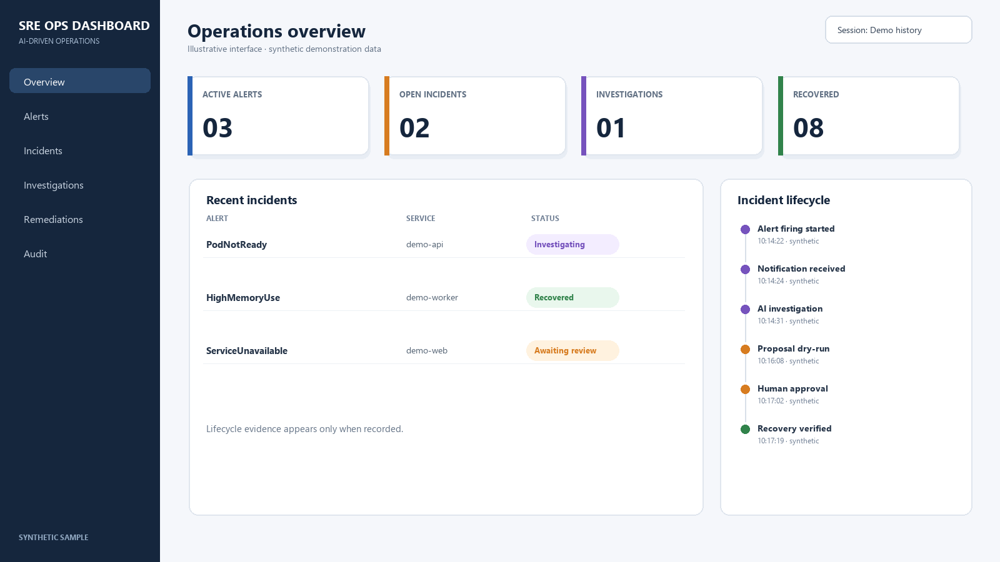
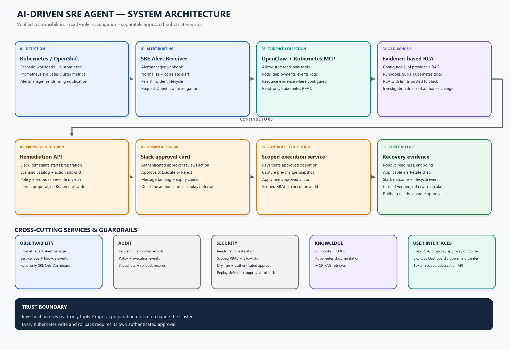

# AI-Driven SRE Agent for Kubernetes

**A human-governed SRE demonstration that connects alert detection, evidence-based AI investigation, policy-bounded remediation proposals, authenticated approval, controlled execution, and audit-backed recovery.**

*Illustrative interface only. All incidents, services, counts, and timestamps in this image are synthetic.*

## At a glance

- **20 Kubernetes failure scenarios** with custom monitoring rules and investigation workflows.
- **Read-only AI investigation** orchestrated by OpenClaw using Kubernetes MCP evidence and RAG references.
- **Human approval before writes:** Slack Remediate prepares a policy-checked, server-side dry-run proposal; a separate authenticated Slack decision authorizes execution.
- **Controlled recovery:** scoped execution permissions, pre-change snapshots, verification, lifecycle persistence, audit, and separately approved rollback proposals.
- **Read-only SRE Ops Dashboard (Command Center)** for alerts, incidents, investigation status, remediation outcomes, audit, and lifecycle evidence.

## Architecture

| Diagram | Preview |
| --- | --- |
| [Eight-stage incident response flow](docs/architecture/incident-response-flow.png) · [editable Mermaid](docs/architecture/incident-response-flow.mmd) | Detection → routing → evidence → diagnosis → proposal → approval → execution → verification |
| [Technical component flow](docs/architecture/technical-component-flow.png) · [editable Mermaid](docs/architecture/technical-component-flow.mmd) | Implemented service responsibilities, persistence, audit, read-only evidence, and the separately authorized rollback branch |
| [Detailed architecture](docs/architecture/system-architecture.png) · [editable Mermaid](docs/architecture/system-architecture.mmd) | Eight stages plus observability, audit, security, knowledge, and user interfaces |

SVG exports are provided beside each PNG for sharp, scalable use in presentations.

## How the demonstration works

1. Prometheus evaluates scenario alert rules and Alertmanager notifies the SRE Alert Receiver.
2. OpenClaw coordinates a read-only investigation using allowlisted Kubernetes MCP tools. The MCP service gathers relevant workload state and retrieves Markdown knowledge references through RAG.
3. The configured LLM provider produces an evidence-oriented RCA and recommendations, which are posted to the Slack investigation thread. The RCA is an investigation result, not approval to change the cluster.
4. An operator selects **Remediate** in Slack. The remediation service validates the scenario catalog, action allowlist, policy and target scope, performs server-side dry-run, persists a proposal, and returns a review card. Proposal preparation does not execute a change.
5. An authenticated human approver selects **Approve & Execute** or **Reject**. Expiry, message/identity binding, one-time authorization, and replay protections guard the decision.
6. After approval, the execution service revalidates the exact operation, captures a snapshot, applies the one approved action with scoped RBAC, records audit events, verifies recovery evidence, and posts the outcome to Slack for the SRE Ops Dashboard to show through its read-only API.
7. Rollback is a separate proposal from an eligible snapshot and requires its own authenticated approval. Restoring configuration alone is not treated as proof of application health.

The SRE Ops Dashboard (Command Center) presents read-only observations from the service API. It has no Kubernetes credentials or direct audit database mount.

## Scenario catalog

See the [20-scenario guide](docs/scenarios.md) for concise descriptions of image, startup, readiness, service, resource, configuration, scheduling, and replica failures.

## Technology

Kubernetes/OpenShift, Prometheus, Prometheus Operator, Alertmanager, Python/FastAPI, OpenClaw, Model Context Protocol (MCP), Markdown-based retrieval-augmented generation (RAG), Slack Bolt/Socket Mode, SQLite persistence, Preact, Vite, and Docker.

## Demonstration evidence

Recorded validation covers alerting and investigation for all 20 scenarios, including MCP evidence and RAG retrieval. A later live demonstration also completed the normal Slack Remediate action, server-side dry-run, authenticated approval, one scoped Kubernetes change, recovery verification, audit recording, and incident closure for a selected failure. A separate readiness exercise executed an independently approved snapshot rollback and restored the prior configuration; the workload remained unhealthy until a subsequent approved correction. This evidence does not establish successful remediation for every scenario or guarantee that rollback restores health. See the [sanitized test and evidence summary](docs/test-summary.md).

## Security architecture

- Investigation tools have read-only Kubernetes permissions.
- The remediation service uses a policy-bounded action catalog and narrow, scoped execution RBAC.
- Server-side dry-run precedes approval; proposal creation alone has no cluster write effect.
- Real Kubernetes writes require an authenticated, bound, unexpired Slack approval and one-time authorization.
- Rollback has its own approval; uncertain execution is reconciled rather than blindly repeated.
- The dashboard uses a separate, token-scoped read API.

See [security architecture](docs/security-architecture.md) and [limitations](docs/limitations.md).

## Try the walkthrough

Start with the [demonstration guide](docs/demo-guide.md), which describes the event sequence, evidence to observe, and approval boundary. This showcase is documentation and demonstration material; it does not include the private application source, credentials, live cluster configuration, private endpoints, incident databases, or audit logs.

## Project status

This is an educational lab demonstration, not a production certification or unattended self-healing system. Service configuration, model provider, monitoring rules, resource scope, and Slack authorization must be reviewed for the target environment. Scenario-specific live remediation and rollback behavior requires independent validation before operational use.

## Future work

These are architecture-aligned extensions, not capabilities claimed as implemented in this prototype:

- **RAG MLOps pipeline:** automate document ingestion, validation, versioning, and retrieval-quality testing for the existing Markdown knowledge corpus and SQLite index.
- **Multi-cluster scale-out:** extend the current lab flow with explicit cluster/tenant scoping, per-cluster identities, and independently reviewed policies.
- **SOP-based governed remediation:** broaden the existing allowlisted action catalog for known low-risk issues, keeping policy checks, server-side dry-run, and authenticated Slack approval.
- **Incident learning loop:** curate reviewed and sanitized RCAs and outcomes into the RAG corpus with provenance and retrieval-quality checks.
- **Alert correlation:** grow the current duplicate suppression into explainable grouping of related alerts into a shared incident.
- **Predictive SRE:** use configured metrics to surface advisory signals for drift, capacity pressure, certificate expiry, and failure patterns; preserve the existing approval boundary for all writes.
- **Broader validation:** run scenario-specific end-to-end checks for proposal, dry-run, approval, execution, verification, and audit across additional catalog scenarios.
